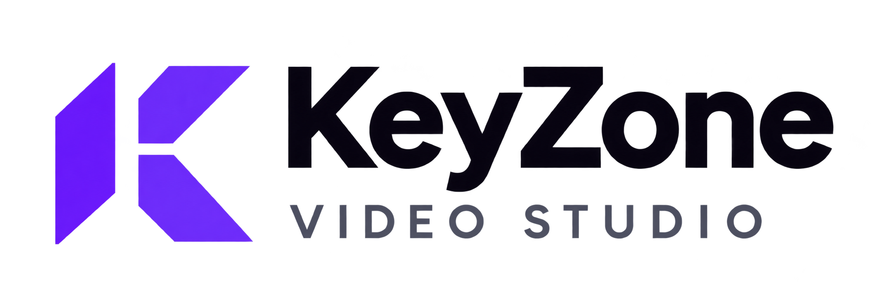

# KeyZone Video Studio

Mã nguồn giao diện hiện tại và toàn bộ pipeline tạo video: nhập ý tưởng hoặc prompt, AI chia cảnh, ảnh sản phẩm nhiều góc, nhân vật tham chiếu, kết nối Muse, tạo clip, ghép MP4 bằng FFmpeg, thumbnail và Shorts.

## Bắt đầu

- **Render.com:** làm theo [DEPLOY-RENDER.md](DEPLOY-RENDER.md). Blueprint ở [render.yaml](render.yaml).
- **Chạy mới bằng Docker:** tạo `.env` từ [`.env.example`](.env.example), thay các mật khẩu/key mẫu, rồi chạy `docker compose up --build -d`. Mở `http://localhost:3000` và đăng nhập bằng tài khoản Studio đã đặt. Cần Docker engine đang chạy.
- **Máy Windows đã có dữ liệu:** giữ nguyên cách chạy trong [RUN-MOONREEL.md](RUN-MOONREEL.md). Các launcher Windows yêu cầu PostgreSQL 18 và môi trường Python được cài sẵn; không tự mang theo database của máy cũ.

## Cấu trúc

| Thư mục / file | Vai trò |
| --- | --- |
| `moonreel/moonreel-studio/src/` | Giao diện mới nhất, API, i18n, database, pipeline render và worker |
| `moonreel/moonreel-studio/public/` | Logo, tài nguyên giao diện và font preview |
| `moonreel/moonreel-studio/assets/fonts/` | Font render video, thumbnail và giấy phép font |
| `muse2api-local/` | Backend Python + Chromium, kết nối tài khoản trong Studio; extension cũ vẫn được giữ như lựa chọn phụ |
| `deploy/` | Khởi tạo schema SQL, giám sát web/worker, kiểm thử triển khai |
| `render.yaml`, `Dockerfile`, `docker-compose.yml` | Cấu hình Render.com và Docker local |
| `docs/SOURCE-INVENTORY.json` | Danh sách mã nguồn lấy từ máy hiện tại, hash và các đường dẫn loại trừ |
| `PUBLISH-MANIFEST.md` | Giải thích đầy đủ phần đưa lên và không đưa lên |

Giao diện gồm quản lý tài khoản, thêm/xóa nhân vật, PC/mobile, import storyboard, AI phân tích prompt và chọn nhiều ảnh sản phẩm bằng icon trong ô nhập. Mỗi cảnh hiện tạo clip khoảng 10 giây. Tất cả ảnh tham chiếu được lưu riêng; khi gửi Muse, nhiều ảnh được ghép thành bảng tham chiếu để không bỏ mất ảnh sau tấm đầu.

## Dữ liệu và phạm vi sử dụng

Repo chứa **mã nguồn**, không chứa tài khoản/cookie Muse, `.env` thật, cơ sở dữ liệu, ảnh/video người dùng hoặc lịch sử làm việc. Bản Render mới bắt đầu với database mới và các ngách mẫu; muốn chuyển dự án cũ phải sao lưu/khôi phục PostgreSQL và thư mục storage qua kênh riêng, không qua Git.

Bản triển khai có một tài khoản HTTP Basic cho toàn Studio, dùng cho cá nhân hoặc nhóm tin cậy. Chưa có tài khoản riêng, phân quyền hoặc dữ liệu tách biệt cho từng khách hàng. Không mô tả đây là SaaS nhiều người dùng hoàn chỉnh.

## Giấy phép và nguồn gốc

- Studio phát triển từ [siri2moon/moonreel](https://github.com/siri2moon/moonreel), giữ [giấy phép gốc](moonreel/LICENSE).
- Backend phát triển từ [bynne2602/muse2api](https://github.com/bynne2602/muse2api), giữ [giấy phép gốc](muse2api-local/LICENSE).
- Tài liệu upstream giữ nguyên trong từng thư mục để tham khảo. Với bản tích hợp này, ưu tiên README này và DEPLOY-RENDER.md thay vì lệnh Docker tải backend upstream cũ.

Xem [VALIDATION.md](VALIDATION.md) để biết các kiểm tra đã chạy và phần chưa được kiểm thử.
